<p align="center">
  
</p>

<h1 align="center">Genius SEO</h1>

<p align="center">
  <b>Free, open-source SEO + AEO plugin for <a href="https://claude.com/claude-code">Claude Code</a>.</b><br>
  Keywords vetted, posts written answer-first, and your brand cited by AI before you publish a word.
</p>

<p align="center">
  <a href="#install">Install</a> ·
  <a href="#commands">Commands</a> ·
  <a href="#how-it-works">How it works</a> ·
  <a href="#data-sources">Data sources</a> ·
  <a href="#rules-it-follows">Rules</a> ·
  <a href="#faq">FAQ</a>
</p>

<p align="center">
  
  
  
  
</p>

---

**Rank in Google and get cited by AI.** Google still sends far more traffic than AI chatbots, and AI answers pull mostly from pages that already rank. So Genius SEO treats SEO as the foundation and layers AEO (answer-engine optimization) on top:

- **Vet before you write.** Every keyword gets 5 checks plus an AI filter → **GO / LONG-TAIL / SKIP**.
- **Write for humans and AI.** Bottom line up front, standalone sections, specific names and numbers.
- **Get named by AI.** Brand gap checks, mention targets by tier, YouTube search-hit plans.
- **Never guesses.** Missing data is marked "unknown", and every published statistic needs a checkable source.

Genius SEO is built from 1 skill, 1 specialist agent and 12 `/genius-seo` commands, and it hands writing and audits to [claude-blog](https://github.com/AgriciDaniel/claude-blog) and [claude-seo](https://github.com/AgriciDaniel/claude-seo).

## Install

<p align="center">
  
</p>

You need [Claude Code](https://claude.com/claude-code). Run these inside Claude Code, then restart it:

```
/plugin marketplace add prikshitmaster/Genius-seo
/plugin install genius-seo@genius-seo
```

<details>
<summary><b>Recommended companions: claude-blog + claude-seo (MIT, by AgriciDaniel)</b></summary>

Genius SEO hands writing, fact-checking and audits to these:

```
/plugin marketplace add AgriciDaniel/claude-blog
/plugin install claude-blog@agricidaniel-blog

/plugin marketplace add AgriciDaniel/claude-seo
/plugin install claude-seo@agricidaniel-claude-seo
```
</details>

<details>
<summary><b>Firecrawl: live Google results + reading any page</b></summary>

Use the claude.ai Firecrawl connector, or set a key from [firecrawl.dev](https://firecrawl.dev). The plugin's `.mcp.json` starts `firecrawl-mcp`.

```
setx FIRECRAWL_API_KEY "fc-..."        # Windows
export FIRECRAWL_API_KEY="fc-..."      # macOS / Linux
```
</details>

**Your first run:**

```
/genius-seo:start                       # where do I start?
/genius-seo:vet "your keyword"          # can we rank for this?
```

## Commands

<p align="center">
  
</p>

12 commands in five groups. Or just talk to it: *"can we rank for X?"* or *"how do I get mentioned by ChatGPT?"* also trigger the skill.

<details>
<summary><b>Plan (4 commands)</b></summary>

| Command | What it does |
|---|---|
| `/genius-seo:start` | Prioritized SEO + AEO plan: technical → measurement → brand gap → biggest gap first |
| `/genius-seo:keywords` | Keyword ideas from seeds + modifiers, live search, People Also Ask, Reddit |
| `/genius-seo:vet <keyword>` | 5 checks + AI filter → GO / LONG-TAIL / SKIP + content plan |
| `/genius-seo:cluster <topic>` | Topic cluster from AI query fan-out: pillar, supporting posts, link map |
</details>

<details>
<summary><b>Write (2 commands)</b></summary>

| Command | What it does |
|---|---|
| `/genius-seo:write <keyword>` | Vet → brief → write answer-first → fact-check → score |
| `/genius-seo:refresh [post]` | Find posts that slipped or went stale and update them (the fastest win) |
</details>

<details>
<summary><b>AI Search (2 commands)</b></summary>

| Command | What it does |
|---|---|
| `/genius-seo:aeo` | Brand gap check: who ChatGPT, Perplexity, Gemini and Claude name and cite |
| `/genius-seo:crawlers [url]` | robots.txt AI-bot blocks, stray noindex, sitemap, CDN bot blocking |
</details>

<details>
<summary><b>Grow (2 commands)</b></summary>

| Command | What it does |
|---|---|
| `/genius-seo:mentions` | Mention and link targets by tier (editorial, Reddit/forums, own channels) + outreach drafts |
| `/genius-seo:youtube` | Evergreen search-hit video topics with title, description, chapters and outline |
</details>

<details>
<summary><b>Measure (2 commands)</b></summary>

| Command | What it does |
|---|---|
| `/genius-seo:measure` | AI referral traffic (GA4), AI bot visits (logs), "how did you hear about us?" |
| `/genius-seo:setup [source]` | Connect Search Console, GA4, Bing, PageSpeed/CrUX, Moz, Firecrawl |
</details>

## How it works

**Keyword vetting: 6 checks, every time**

| # | Check | Question |
|---|---|---|
| 1 | Search demand | Do people search it, and do they click? |
| 2 | Traffic potential | How much traffic does the #1 page get overall? |
| 3 | Business potential | 0–3: how naturally does your offer fit? |
| 4 | Search intent | Does the content type, format and angle match what ranks? |
| 5 | Can you compete? | More backlinks? Similar authority? More topical authority? Something better to offer? |
| 6 | AI filter | Can AI answer it with no click? Then aim for a brand mention instead |

**Writing rules:** bottom line up front · atomic sections · entity-rich · simple declarative sentences · fresh · one CTA.

**AEO levers:** content on your site · mentions on other sites · YouTube · technical access for AI crawlers.

<details>
<summary><b>What's inside the plugin</b></summary>

| Part | What it does |
|---|---|
| `skills/genius-seo/SKILL.md` | The brain: full playbook, picks the right tool for each task |
| `agents/seo-keyword-scout.md` | Runs the 6 checks against live results |
| `commands/` | The 12 `/genius-seo:*` commands |
| `skills/genius-seo/references/seo-checklist.md` | Keyword checks, on-page, links, technical |
| `skills/genius-seo/references/aeo-notes.md` | Query fan-out, brand gaps, citation levers, measurement |
| `skills/genius-seo/references/setup.md` | Connecting free data sources |
| `.mcp.json` | Firecrawl MCP server |
</details>

It adapts to your business from your project's `CLAUDE.md` or `.genius-seo/business.md`, and asks you once if neither exists.

## Data sources

| Source | Cost | Gives |
|---|---|---|
| Web search + Firecrawl | Free / free tier | Live results and any page's content |
| Google Search Console | Free | Your real queries, clicks, positions |
| GA4 | Free | Which posts convert |
| Bing Webmaster + IndexNow | Free | Backlinks, fast indexing (feeds ChatGPT search, Copilot) |
| PageSpeed + CrUX | Free | Core Web Vitals for any URL |
| Moz (free tier) + Common Crawl | Free | Authority and links for any domain |
| DataForSEO | Paid | Search volume, competitor keywords, content gaps |

Setup steps: [`references/setup.md`](skills/genius-seo/references/setup.md) or `/genius-seo:setup`.

## Rules it follows

- Never invents numbers; missing data is "unknown", and it names the tool that would answer it.
- Every published statistic needs a checkable source; regulated topics (immigration, legal, medical, finance) use official sources only.
- Never publishes, deploys, pushes or sends outreach without your OK.

## FAQ

<details>
<summary><b>Is SEO dead because of AI?</b></summary>

No. AI assistants split one prompt into many searches against search indexes, and most AI Overview citations come from pages that already rank. SEO is the foundation of AEO.
</details>

<details>
<summary><b>Do I need paid tools?</b></summary>

No. It works with web search and Firecrawl, and the free Google, Bing and Moz APIs cover most checks. DataForSEO is the only paid upgrade, for exact volume and competitor keyword data.
</details>

<details>
<summary><b>Does it work for any business?</b></summary>

Yes. It reads your business profile and tailors business-potential scoring, service links and the CTA. The reference notes use a career-coaching business as the worked example.
</details>

## License

MIT, see [LICENSE](LICENSE). Brand names in the artwork belong to their owners.

<p align="center">
  
</p>

<p align="center">
  <a href="https://github.com/prikshitmaster"></a>
  <a href="https://github.com/prikshitmaster/Genius-seo"></a>
</p>
